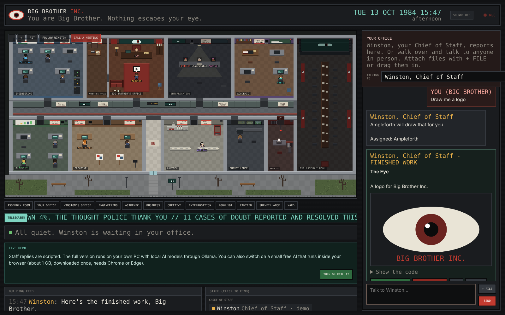
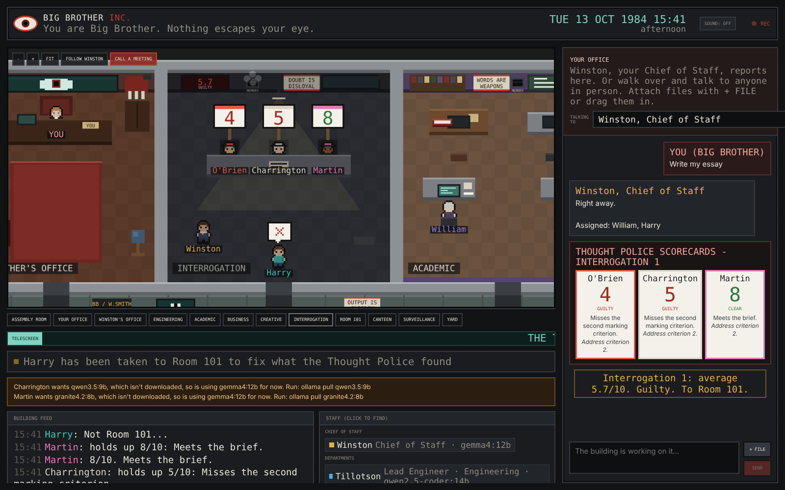
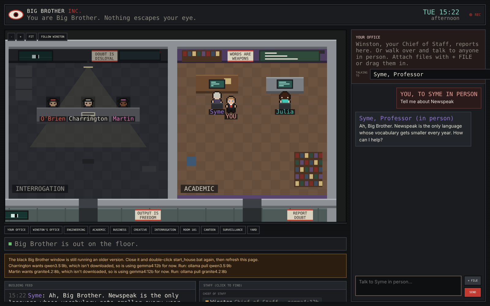
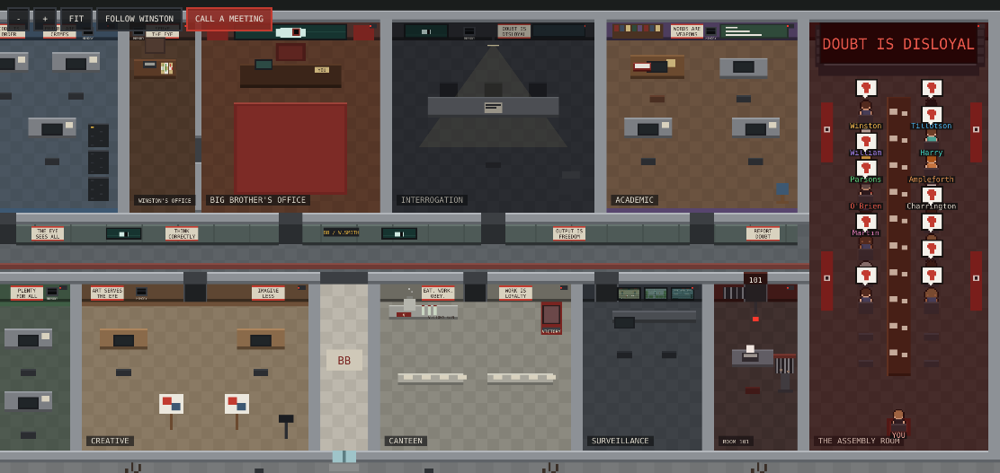

# Big Brother Inc.

**A multi-agent AI company, run from your own PC, set in Orwell's 1984.**

You are Big Brother. Give an order to Winston, your Chief of Staff, and watch it ripple through a pixel-art office:
he walks to the right department, the staff write the work at their desks, the Thought Police interrogate it,
and Winston brings it back for your verdict. Every character is a real language model running locally through
[Ollama](https://ollama.com). No cloud, no API bills.

**[Try the live demo](https://harrygreener01-cloud.github.io/big-brother-inc/)**: scripted by default, with an
option to run a small AI model inside your browser.



## What it does

- **Delegation, not one chatbot.** Winston (Chief of Staff) reads each request and decides who should handle it:
  Engineering (code and websites), Academic (a Professor breaks down university briefs, a Scholar writes the work),
  Business (ideas and pricing) or Creative (writing, slogans and images drawn as SVG).
- **Built-in quality control.** For anything substantial, the work goes to the **Thought Police**: three reviewers
  on *different* model families, so they catch different mistakes. They score blind, out of 10, and hold up scorecards.
  Guilty work is sent to **Room 101** to be fixed. Quick jobs skip review.
- **You have the final say.** Approve work for release (saved to disk) or send it back to Room 101 with your notes.
  A records archive keeps both approved and rejected work.
- **Talk to anyone.** Walk over to any member of staff (or call them into your office) and talk to them directly.
- **Reads your files.** Drop in PDFs, Word documents, PowerPoints, text or code, and the staff work from them.
- **Shows real output.** Images (SVG) and web pages appear as actual pictures and live previews, with the code underneath.
- **A living building.** The building follows the real clock: staff arrive in the morning, take canteen breaks,
  get spot-checked by the Thought Police and go home at night. Call everyone to the Assembly Room for a rally.



## How it works

```
You (Big Brother)
   |
Winston, Chief of Staff  ----  decides: chat, ask a question, or delegate (and whether review is needed)
   |
Departments  ---------------  each person is a local model with their own persona, skills and model choice
   |                           (later staff build on earlier staff's work; writing streams live to their screen)
Thought Police  ------------  three blind reviewers on different models score the work; failures go to Room 101
   |
Winston -> You  -------------  approve for release, or send back with notes
```

- **Backend:** a single dependency-free Python file (`server.py`) that orchestrates the agents, talks to Ollama's
  API, streams live events to the browser (Server-Sent Events) and handles files and records.
- **Frontend:** one HTML file. The office is drawn on a canvas with hand-made pixel sprites, pathfinding along
  corridors, a day/night cycle, zoom and pan, and procedurally generated sound effects.
- **Configurable cast:** every character's name, role, personality and model lives in `housemates.json`.
  Remove someone and they become an *unperson*.

| Role | Default model |
|------|---------------|
| Winston, William, Harry, Parsons, Ampleforth, O'Brien | `gemma4:12b` |
| Tillotson (Engineering) | `qwen2.5-coder:14b` |
| Charrington (Thought Police) | `qwen3.5:9b` |
| Martin (Thought Police) | `granite4.2:8b` |

## Run it on your PC

Designed for a Windows PC with a 12 GB graphics card (developed on an RTX 3060).

1. Install [Ollama](https://ollama.com) and [Python](https://www.python.org/downloads/) (tick "Add python.exe to PATH").
2. Download the models:
   ```
   ollama pull gemma4:12b
   ollama pull qwen2.5-coder:14b
   ollama pull qwen3.5:9b
   ollama pull granite4.2:8b
   ```
3. Double-click `start_house.bat` (or run `python server.py`). The office opens at http://localhost:8765.

Anyone whose model isn't downloaded borrows the default model, so it works with just `gemma4:12b`.



## Controls

- Type to Winston in **Your office**. Attach files with **+ FILE** or drag them in.
- **Talking to**: pick anyone. **WALK OVER** walks you to them; **CALL THEM IN** brings them to you.
- Mouse wheel to zoom, drag to pan, double-click a room to zoom into it.
- **CALL A MEETING** summons everyone to the Assembly Room. **RECORDS** opens approved and rejected work.
- **SOUND** turns on the telescreen hum, chimes and the Room 101 buzzer.



---

Inspired by George Orwell's *Nineteen Eighty-Four*. Slogans and art are original.
